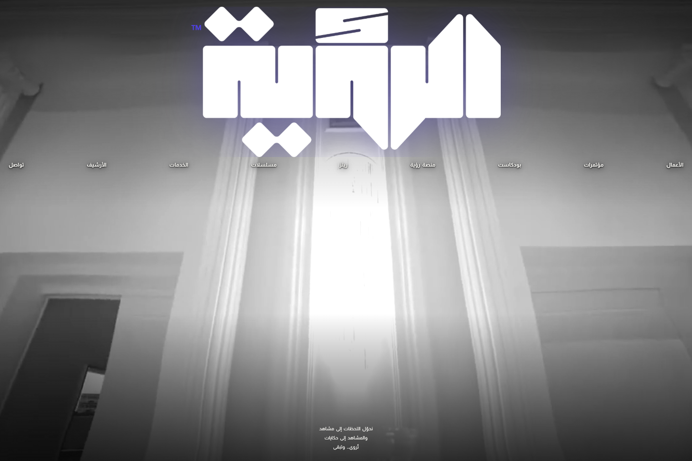
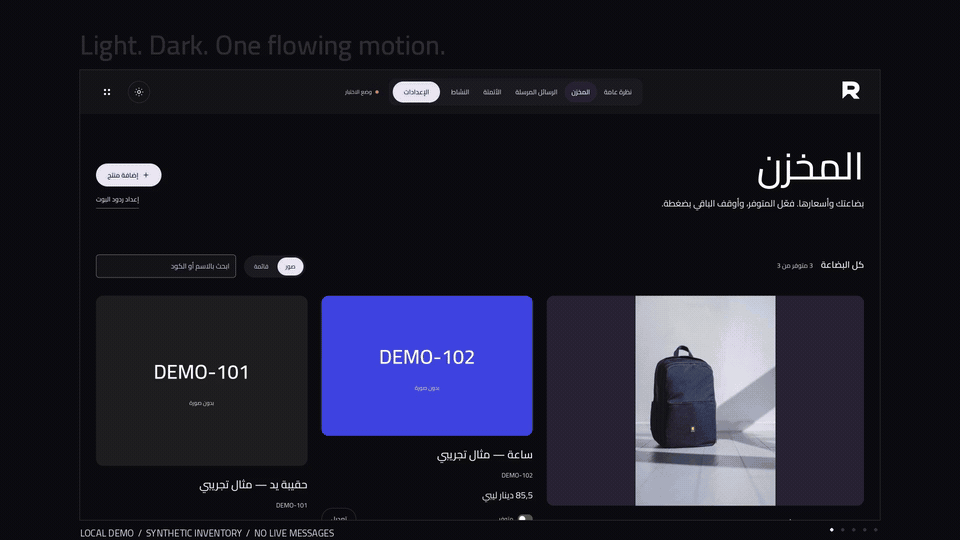

# Selected work · Mohamed Bay

Arabic-first apps, practical business tools and the systems behind them.

I’m a network engineer and developer based in Libya. I work on development, system improvements and technical problem-solving at **Gram Medical**, and I’m a co-founder at [Etaar](https://etaar.ly). My work spans mobile apps, web platforms, business systems and infrastructure.

هذه مساحة لعرض المشاريع وفكرتها والتقنيات المستخدمة. السورس كود للمشاريع التجارية والخاصة يبقى خاصًا.

[فهرس كل المشاريع · Full catalog](PROJECTS.md) · [Experience](EXPERIENCE.md) · [Image sources](assets/README.md)

## Projects · المشاريع

### منصة رؤية · ROUIA Platform

منصة للحلقات والشورتات والاستماع الصوتي، مرتبطة بشركة رؤية للإنتاج والتسويق الإعلامي.

Arabic podcasts, shorts and an audio player that continues across internal navigation.

**My work:** Web-platform development through Etaar: episode discovery, audio listening, responsive interfaces and private content workflows.

**Availability:** Public visitor platform · private source and administration.

[Overview & screens →](projects/rouia-platform.md) · [Visit platform →](https://podcast.alrouia.ly/)

### الرؤية الفنية · ROUIA company website

موقع شركة رؤية لعرض الأعمال المرئية والخدمات والأرشيف وربطها بمنصة البودكاست.

A cinematic Arabic portfolio for media-production work, services and the studio’s podcast.

**My work:** Website development and delivery through Etaar, including video playback, project previews and the podcast connection.

**Availability:** Public company website · private source.

[Overview & screens →](projects/alrouia.md) · [Visit website →](https://alrouia.ly/)

### REPLY

مخزون منظّم ورد واضح للزبون من كود المنتج، بواجهة عربية وإنجليزية.

Merchant inventory and product-code replies, with bilingual workflows and isolated customer workspaces.

**My work:** Merchant inventory, product replies, bilingual interface and Node pilot development on an attributed open-source foundation.

**Availability:** Open source · locally verified pilot; live setup still required.

[Overview & screens →](projects/reply.md) · [Code & docs →](https://github.com/mohamedkbay/REPLY) · [Product film →](https://github.com/mohamedkbay/REPLY/blob/main/docs/media/Reply-Showcase.mp4)

### UpDent · أب دنت

تطبيق للعيادات وأطباء الأسنان لتنظيم ملفات المرضى والعلاجات والمواعيد والمتابعات.

Dental clinic workflows on Android and iOS, with companion web tools.

**My work:** Mobile application development, product interfaces and companion web workflows for dental teams.

**Availability:** Android & iOS app · private source; companion web tools have their own development stage.

[Overview & screens →](projects/updent.md) · [Website & app links →](https://updent.ly)

### Glory Platform · GloryTech Academy

منصة عربية لمركز التدريب، من اكتشاف الدورات إلى لوحة الطالب والدروس ومتابعة التقدّم.

An Arabic training platform for networking, infrastructure and IT education.

**My work:** Training-platform development across course discovery, student journeys and the learning dashboard.

**Availability:** Development preview with demo mode · private source.

[Overview & screens →](projects/glory-platform.md)

### فكّرني · Fakkerni

قول التذكير بالعربي أو باللهجة الليبية، راجعه وعدّله، ثم وافق على حفظه والتنبيه عليه.

Arabic-first voice reminders with review before saving, on native Android and iOS apps.

**My work:** Native Android and iOS application development for the voice, reminder-review and scheduling workflow.

**Availability:** Public source & downloads · native Android and iOS.

[Overview & screens →](projects/fakkerni.md) · [Source & downloads →](https://github.com/mohamedkbay/fakkerni)

### مساجدنا · Masajiduna

مواقيت الصلاة والمساجد القريبة والأذكار وإذاعة القرآن في تجربة عربية واحدة.

A Flutter prayer companion with mosque discovery and a companion website.

**My work:** Flutter app and companion website development across prayer times, mosque discovery, notifications and Quran radio.

**Availability:** Public product website · private source; store availability follows the website.

[Overview & screens →](projects/masajiduna.md) · [Visit website →](https://masajiduna.ly)

### نبضة · Nabda

يربط هاتف أندرويد بلوحة تحكم محلية أو API، لتنظيم طابور الرسائل ومتابعة حالتها.

An Android messaging agent, a Windows controller and a self-hosted business messaging API.

**My work:** Application and integration development across the Android agent, local controller, queues and messaging API.

**Availability:** Private product development · website preview shows a simulated message flow.

[Overview & screens →](projects/nabda.md)

### فوترة · Fawtara

أرشيف لصور الفواتير والبحث فيها من الهاتف، مع تصور منفصل لنسخة Flutter والتنبيهات والتحليل الاختياري.

A browser invoice archive, plus a separate mobile design proposal for local records and financial alerts.

**My work:** Browser invoice workflow development and a mobile interface/motion proposal for the planned Flutter edition.

**Availability:** Browser source available · Flutter, local SQLite, alerts and Qwen remain a design proposal.

[Overview & screens →](projects/fawtara.md) · [Browser source →](https://github.com/mohamedkbay/fawtara-public)

## More projects · بقية الشغل

### Mobile & learning

- **[Live Transcribe · التفريغ اللحظي](projects/live-transcribe.md)** — مساحة للكاتب وشاشة للجمهور، لعرض النص المكتوب لحظياً على جهاز آخر وحفظه في النهاية.
- **[Fermo mobile application](projects/fermo.md)** — واجهات تطبيق موبايل لأدوار الزبون والسائق والمورّد، مع مسارات مختلفة لكل دور.

### Healthcare & operations

- **[Hospital CRM & communications](projects/hospital-crm.md)** — مساحة عربية للمحادثات والحجوزات والمتابعات وتوزيع العمل بين أقسام المستشفى.
- **[IDC Clinic Manager](projects/idc-clinic-manager.md)** — منظومة عربية لإدارة المرضى والزيارات والمواعيد والأطباء والموظفين وواجهات التقارير.
- **[Car Pulse](projects/car-pulse.md)** — تنظيم خطوات فحص المركبات وتوثيق الملاحظات والأضرار وتجهيز تقرير للزبون.
- **[Wisam clinic website](projects/wisam-clinic.md)** — موقع للعيادة يعرّف بخدماتها وفريقها ومعلوماتها للزائر.

### Business systems

- **[Salem accounting application](projects/salem-accounting.md)** — تنظيم فواتير وحسابات المقاولين والمورّدين والمدفوعات وحركة النقد لنشاط مواد بناء.
- **[الخراز · Khirazz POS](projects/khirazz.md)** — نقطة بيع للويب وWindows تحفظ البيانات محلياً، مع مزامنة اختيارية عند الاتصال.
- **[SouqFlow POS](projects/souqflow.md)** — مساحة نقاط بيع تركّز على Windows وتجمع المبيعات والمخزون والعملاء والتقارير.
- **[AL-HADAF ERP](projects/al-hadaf-erp.md)** — منظومة أعمال لمواد البناء وخدمات المقاولات، بواجهات للمبيعات والمخزون والمورّدين والتقارير.
- **[ALAZOZI ERP](projects/alazozi-erp.md)** — منظومة مخصّصة لنشاط مواد البناء، لتنظيم البيع والمخزون والحسابات الإدارية.
- **[Selal ERP](projects/selal-erp.md)** — واجهات نقطة بيع وإدارة مخزون ومورّدين، مع لوحة متابعة وتقارير.
- **[حِسبة · Hisba](projects/hisba.md)** — متابعة تكاليف المقهى ووصفاته ومبيعاته ومصروفاته لفهم الربح بصورة أوضح.
- **[الوزنة · Wazna](projects/wazna.md)** — تنظيم وصفات المقهى والمواد الخام وتسجيل الاستهلاك والهدر والرجوع للأرشيف.
- **[AlWatnya Marine Systems](projects/alwatnya-marine.md)** — مساحة لإدارة مبيعات ومخزون وصيانة وحسابات نشاط المعدات البحرية.
- **[منظومة المسوقين · Msueq](projects/msueq.md)** — مساحة عمل للتسويق والمبيعات، لتنظيم المنتجات ومتابعة النشاط من لوحات وتقارير.

### Media & websites

- **[Etaar storefront & administration](projects/etaar-commerce.md)** — واجهات متجر إلكتروني وأدوات إدارة مساندة للمنتجات والعلامات والطلبات ومتابعة المبيعات.
- **[درع التقنية · TechShield](projects/techshield.md)** — موقع شركة تقنية يعرض خدمات البرمجيات والشبكات والبنية التحتية.

## Explore more

[Full project catalog →](PROJECTS.md) · [Experience & areas of work](EXPERIENCE.md) · [Freelance & company collaboration account](https://github.com/mohamedbay)

[Personal website](https://mohamedbay.ly) · [Etaar](https://etaar.ly) · [Midad](https://midad.com.ly) · [GitHub profile](https://github.com/mohamedkbay)

This gallery contains project overviews and presentation material. Each project states its availability; private application source and operational data stay private. [Image context and credits](assets/README.md).
