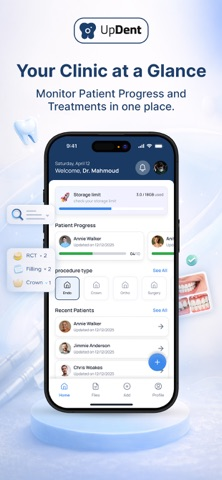
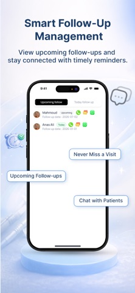
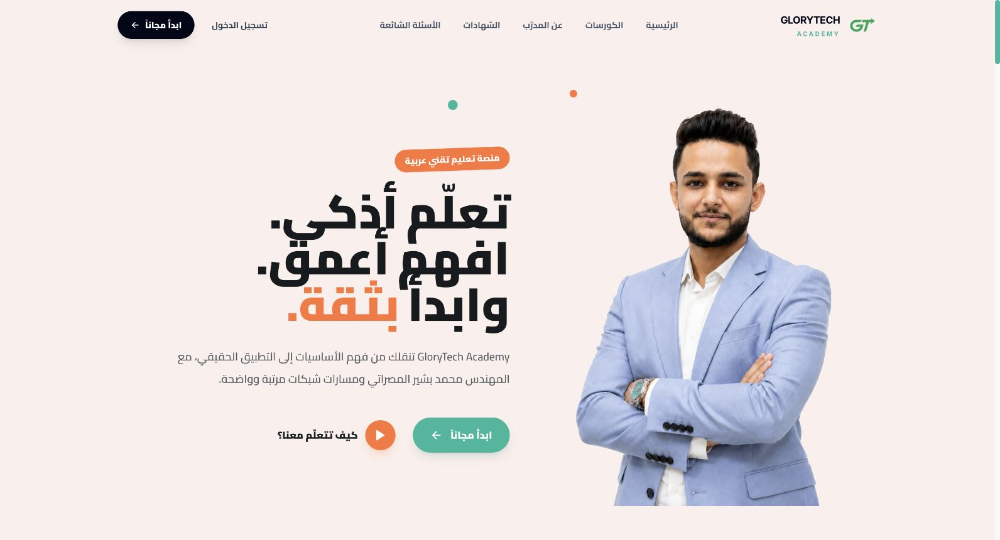
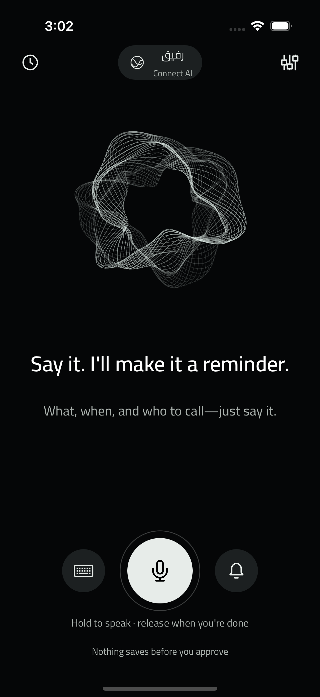
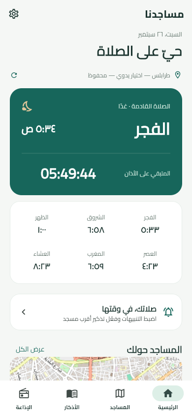
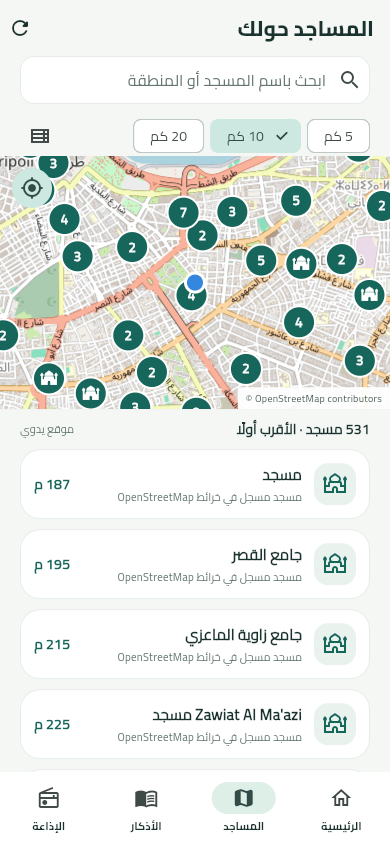
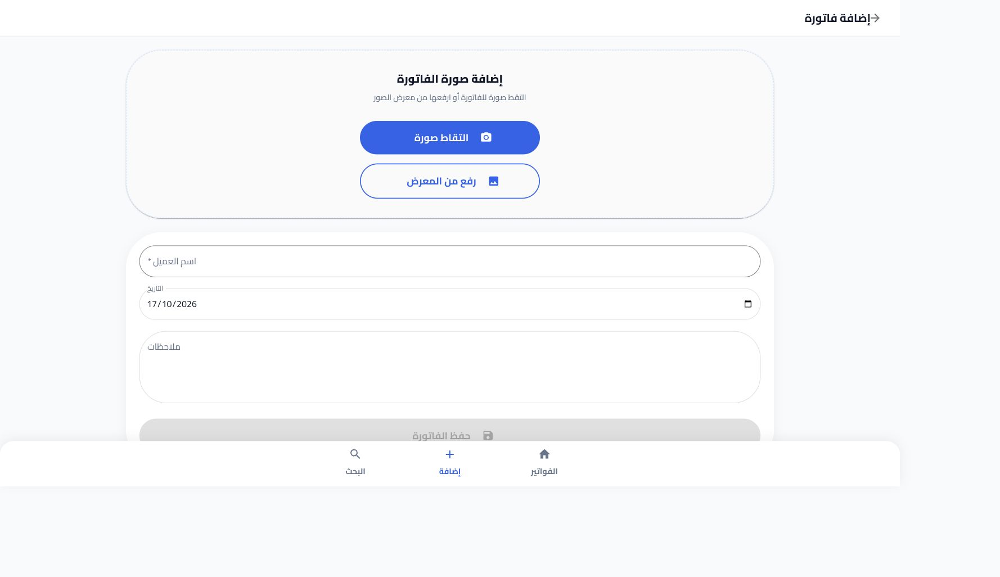

# Selected work · Mohamed Bay

Arabic-first apps, practical business tools and the systems behind them.

I’m a network engineer and developer based in Libya. I work on development, system improvements and technical problem-solving at **Gram Medical**, and I’m a co-founder at [Etaar](https://etaar.ly). My work spans mobile apps, web platforms, business systems and infrastructure.

هذه مساحة لعرض المشاريع وفكرتها والتقنيات المستخدمة. السورس كود للمشاريع التجارية والخاصة يبقى خاصًا.

## Visual previews

صور من التطبيقات ومعاينات الواجهات. افتح صفحة المشروع لمشاهدة الصور الأكبر وتفاصيل كل معاينة.

<table>
<tr><th width="50%">UpDent · Mobile app</th><th width="50%">Glory Platform · Training academy</th></tr>
<tr>
<td align="center" valign="top">

Patient workflows and follow-ups on Android and iOS.

<a href="projects/updent.md">Explore UpDent →</a>
</td>
<td align="center" valign="top">

An Arabic course catalog and student learning experience.

<a href="projects/glory-platform.md">Explore Glory →</a>
</td>
</tr>
<tr><th>فكّرني · Fakkerni</th><th>مساجدنا · Masajiduna</th></tr>
<tr>
<td align="center" valign="top">

Speak a reminder, review it and save it.

<a href="projects/fakkerni.md">View app screens →</a>
</td>
<td align="center" valign="top">

Prayer times and nearby mosques in an Arabic mobile interface.

<a href="projects/masajiduna.md">Explore Masajiduna →</a>
</td>
</tr>
<tr><th>نبضة · Nabda</th><th>فوترة · Fawtara</th></tr>
<tr>
<td align="center" valign="top">

A messaging product website and simulated delivery flow.

<a href="projects/nabda.md">Explore Nabda →</a>
</td>
<td align="center" valign="top">

Capture an invoice image and organize its details.

<a href="projects/fawtara.md">Explore Fawtara →</a>
</td>
</tr>
</table>

UpDent uses published promotional images. Glory, Nabda and Fawtara use local development previews; the student account is a demo and the invoice forms are empty. [Image sources](assets/README.md).

## Projects

| Project | Purpose | Technology | Explore |
| --- | --- | --- | --- |
| **UpDent** | An Android and iOS mobile app for dental clinic workflows, with companion web tools. | Mobile app · web interfaces | [Overview](projects/updent.md) · [Website](https://updent.ly) |
| **Glory Platform · GloryTech Academy** | An Arabic learning platform for networking and IT training. | React · TypeScript · course and student interfaces | [Overview](projects/glory-platform.md) |
| **فكّرني · Fakkerni** | Capture an Arabic voice reminder, review it and schedule an alert. | Java · SwiftUI | [Preview](projects/fakkerni.md) · [Source & downloads](https://github.com/mohamedkbay/fakkerni) |
| **مساجدنا · Masajiduna** | Prayer times, nearby mosques, daily adhkar and Quran radio. | Flutter · Dart · React | [Overview](projects/masajiduna.md) · [Website](https://masajiduna.ly) |
| **نبضة · Nabda** | Connect an Android phone to a messaging controller and API. | TypeScript · Java · PostgreSQL · Redis | [Overview](projects/nabda.md) |
| **فوترة · Fawtara** | Capture, organize and find invoice images from a phone. | React · TypeScript · MUI | [Overview](projects/fawtara.md) |

## A closer look

- **[UpDent](projects/updent.md):** a dental mobile app and supporting web workflows.
- **[Glory Platform](projects/glory-platform.md):** course discovery, a student dashboard and an Arabic learning experience.
- **[Masajiduna](projects/masajiduna.md):** location-aware discovery and a daily Arabic mobile experience.
- **[Nabda](projects/nabda.md):** Android, a Windows controller and a self-hosted messaging API.
- **[Fawtara](projects/fawtara.md):** a focused workflow for invoice capture and retrieval.

## Beyond the featured projects

**[Full project catalog →](PROJECTS.md)** — ERP, café operations, vehicle inspection, healthcare tools, e-commerce, websites and other applications.

**[Experience & areas of work →](EXPERIENCE.md)** — Gram Medical, Etaar, previous roles and technical responsibilities.

## More

[Personal website](https://mohamedbay.ly) · [Etaar](https://etaar.ly) · [Midad](https://midad.com.ly) · [GitHub profile](https://github.com/mohamedkbay)

This repository contains project descriptions and public presentation material. It does not contain the private applications’ source code, credentials or operational data. Project overviews describe scope, not a claim of independent testing or production readiness.
