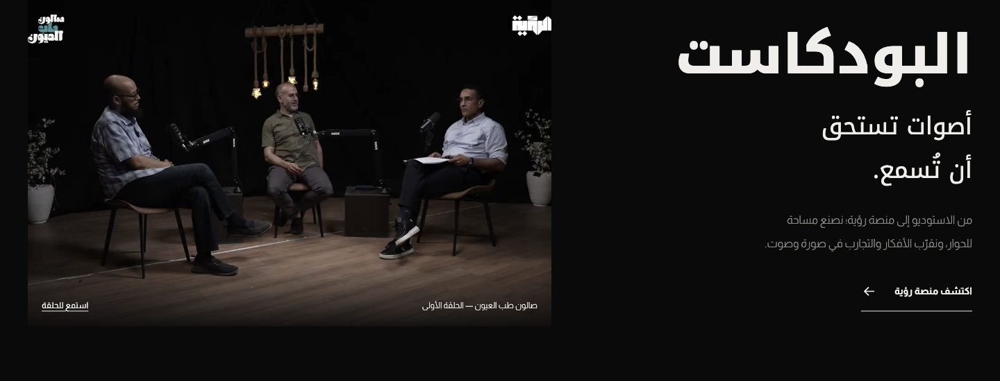

# الرؤية الفنية · ROUIA company website

**A cinematic Arabic website for a media production and marketing company.**

[Visit alrouia.ly →](https://alrouia.ly/) · [ROUIA Platform](rouia-platform.md) · [Back to selected work](../README.md)

موقع شركة الرؤية الفنية للإنتاج والتسويق الإعلامي: معرض للأعمال والفيديوهات، عرض للخدمات وأرشيف المشاريع، وقسم للبودكاست يربط الزائر بمنصة رؤية.

**Availability:** Public company website · private source.

## My contribution · دوري

Website development and delivery through **Etaar Digital Systems**: refining the Arabic web experience, integrating local video playback and project previews, linking the podcast platform, and preparing the static build for hosting. The work preserves Rouia’s established visual identity, production media and existing credits.

تطوير وتجهيز الموقع عبر **إطار للأنظمة الرقمية**، مع تحسين تشغيل الفيديوهات ومعاينات الأعمال، وربط قسم البودكاست بالمنصة، وتجهيز نسخة الموقع للاستضافة. الهوية والأعمال المرئية تخص شركة رؤية وأصحابها.

## The experience

- A visual portfolio with silent previews and full videos with sound on demand.
- Media-production services, project archive and interactive navigation.
- A dedicated podcast section introducing **صالون طب العيون**, with links to the viewing and listening platform.
- Arabic RTL, responsive layouts and reduced-motion support.

## Interface previews

Existing project documentation captures, reviewed on 20 October 2026. These are visitor-facing screens; the videos, branding and production content retain their original ownership.

## Technology and delivery

HTML · CSS · JavaScript, with Node.js build and development tools. The delivered website can be served as static files; its visitor experience does not require an application database.

The official homepage was accessible during the portfolio update on 20 October 2026. This showcase presents the site and development scope; it does not reproduce the company’s media library or application source.

## Part of the ROUIA ecosystem

The company website introduces the studio, its services and production work. **[ROUIA Platform](rouia-platform.md)** provides the companion experience for episodes, shorts and audio listening.

**Availability:** public website, private source. [Image context and credits](../assets/README.md).
