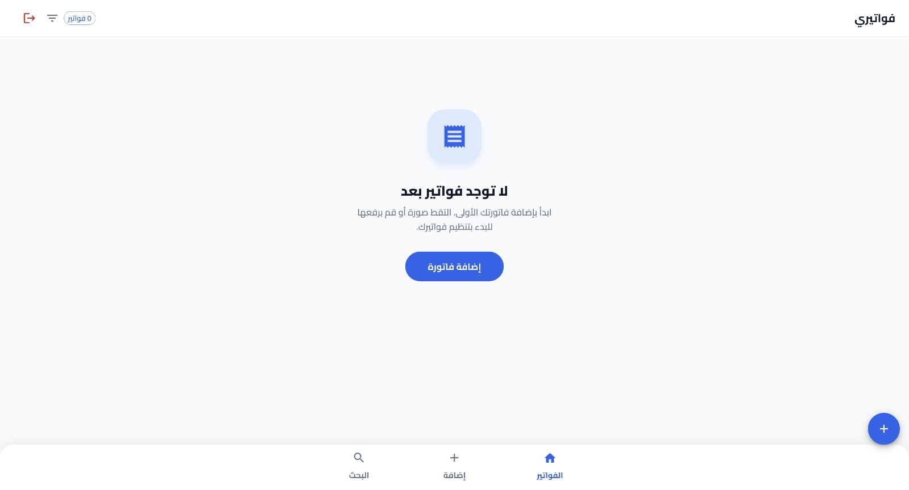

# فوترة · Fawtara

**A mobile-first workspace for organizing invoice images.**

[Back to selected work](../README.md)

## Interface previews

View the empty invoice archive

Captured from a local preview with an empty archive and blank invoice fields. No customer invoices or account records are shown.

## The idea

Make it easier to capture invoices from a phone and find them later by client, date or notes.

فوترة ينظّم صور الفواتير مع اسم الزبون والتاريخ والملاحظات، ويسهّل البحث والرجوع لها من الهاتف.

## Development scope

- Camera capture and gallery uploads, with image compression and previews.
- Invoice records with client names, dates and notes.
- Search, date filters, sorting and full-screen image viewing.
- A responsive interface with a workflow designed around mobile use.

## Technology

React · TypeScript · Material UI · Zustand · Vite

## Availability

The hosted application uses an access-code screen. This overview does not provide access to private invoices or accounts. Source code remains private.
