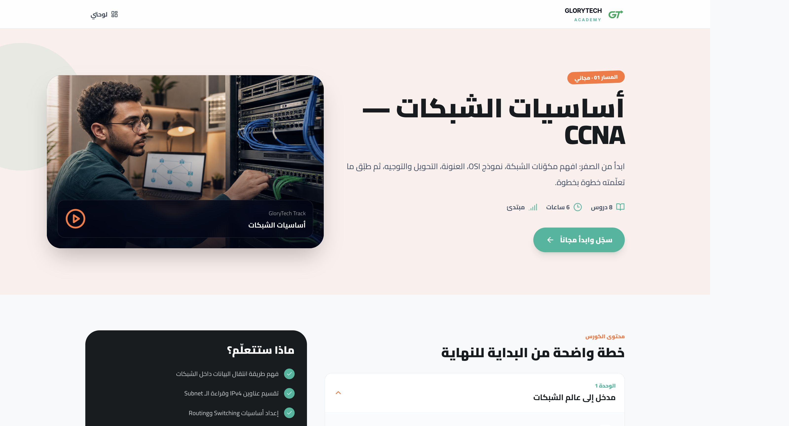
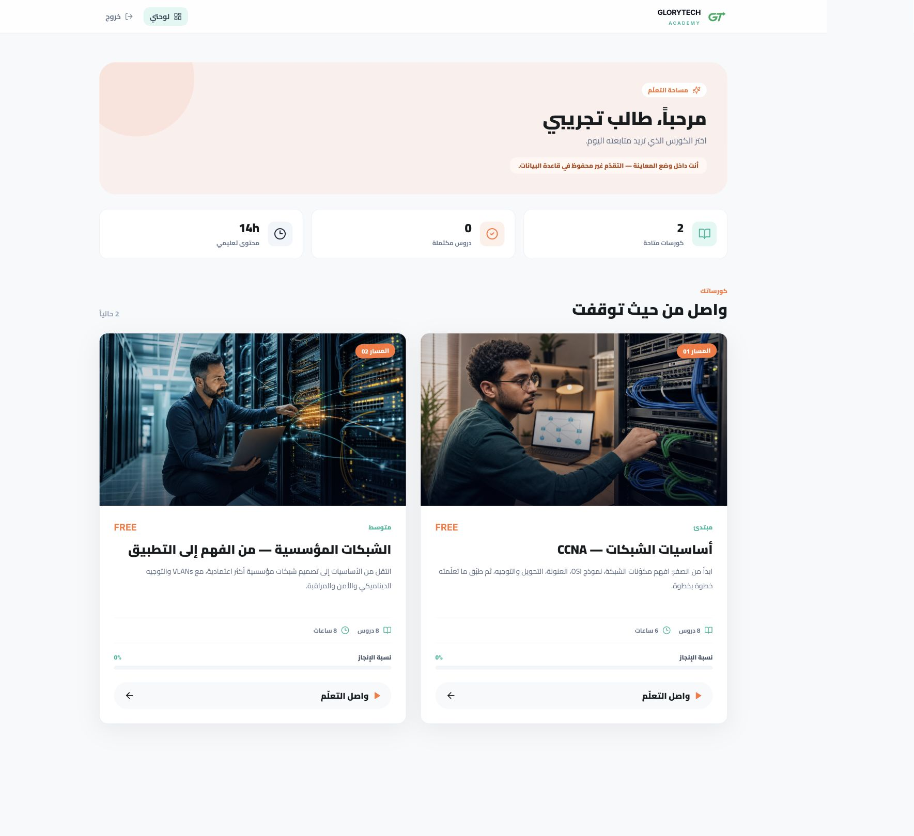

# Glory Platform · GloryTech Academy

**An Arabic training platform for networking, infrastructure and IT education.**

[Back to selected work](../README.md)

## Platform previews

### Arabic landing page

<table>
<tr><th width="50%">Course overview</th><th width="50%">Student dashboard · Demo</th></tr>
<tr>
<td valign="top"></td>
<td valign="top"></td>
</tr>
</table>

Captured from the actual local development preview. The dashboard uses the built-in demo student; no real learner records are shown. Click an image to view it larger.

## The idea

Give a training academy a clear online home for course discovery and a structured learning experience for students.

منصة Glory لمركز التدريب: عرض الدورات، تفاصيل المحتوى، لوحة الطالب، متابعة الدروس والتقدّم، بواجهة عربية تدعم الاتجاه من اليمين لليسار.

## My work

Development of the training platform and its web interfaces, including course discovery, student journeys and the learning dashboard.

## Platform scope

- A searchable course catalog with modules, lessons and learning outcomes.
- Course pages and a responsive Arabic interface.
- Student registration and sign-in interfaces.
- A student dashboard, enrollment flow and lesson completion tracking.
- Lesson presentation, including embedded training material.
- Available and coming-soon course states.

The training content is associated with **Eng. Mohamed Bashir Al-Misrati**. Networking Foundations and Enterprise Networking are represented in the current course catalog; additional tracks are planned.

## Technology and stage

React · TypeScript · Vite · React Router · Tailwind CSS · database and authentication integration.

The project includes a demo mode and backend integration work. A hosted deployment needs its authentication, email delivery and persistence configured before real student onboarding. This overview presents the platform development; source code stays private.
