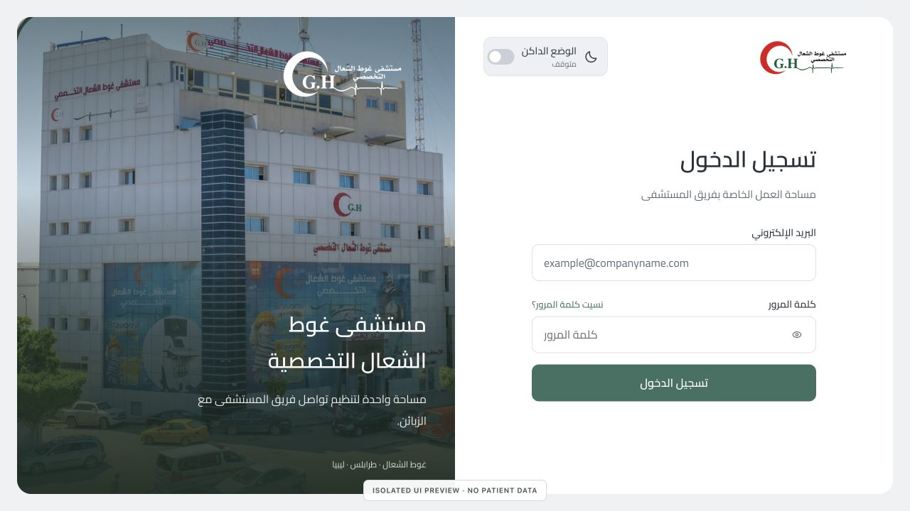
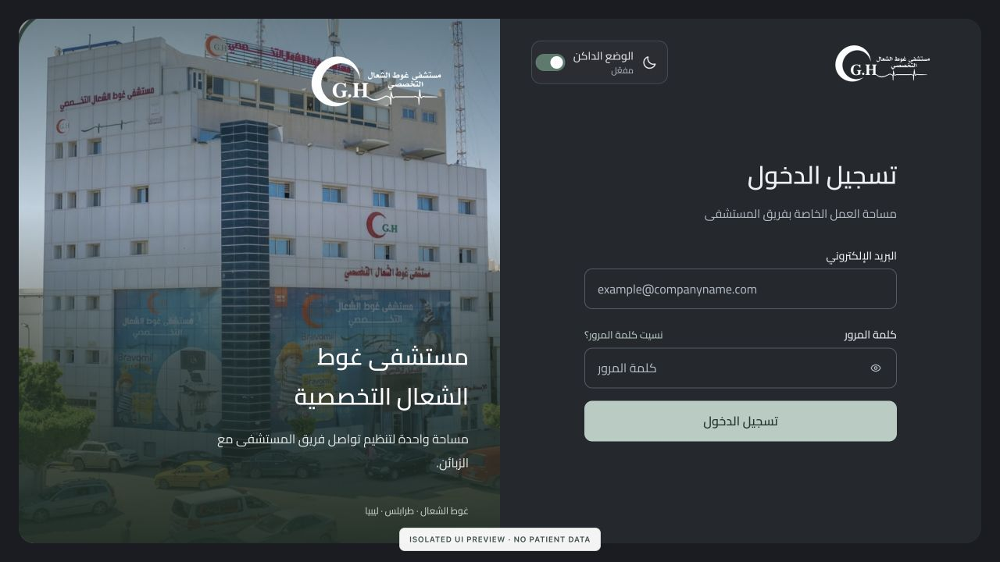
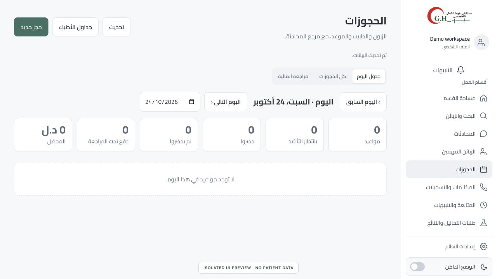
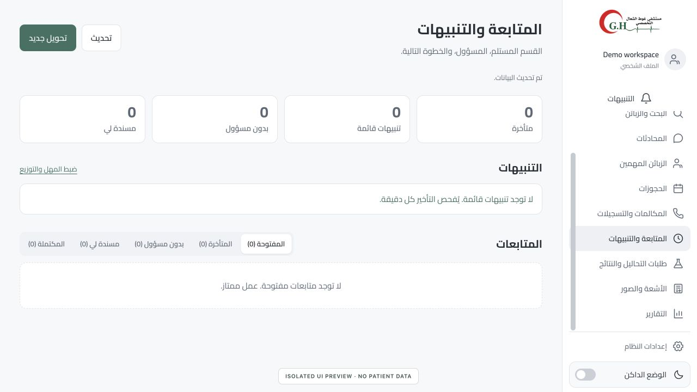

# Ghout Al-Shaal Hospital

**Hospital CRM, departmental workflows and communications in one staff workspace.**

[Project gallery](../README.md) · [Full catalog](../PROJECTS.md)

**Availability:** Private hospital system · public interface previews only.

## Sign-in experience

The hospital’s existing identity, building photograph and staff sign-in interface. Both credential fields are empty.

View the dark-mode sign-in

## Workflow previews

### Bookings and financial review

A daily appointment view, booking actions and payment-review navigation. All counts and lists come from an empty local preview fixture; they are not hospital operating figures.

### Follow-ups and alerts

Departmental handoffs, responsibility, open tasks and escalation/alert surfaces. The preview contains no patient requests, staff records or message content.

## My contribution

Custom hospital workflow development, interface branding and communications integration on **Chatwoot Community** and **FreeSWITCH** foundations. My work connects departmental routing, bookings, follow-ups, records and reporting interfaces with the hospital’s staff workflows.

## Product scope

- Hospital-branded sign-in, light/dark themes and responsive staff interfaces.
- Conversation routing and departmental/staff access workflows.
- Doctor scheduling, bookings and customer-record workflows.
- Laboratory and imaging request interfaces, with document and follow-up workflows.
- Departmental handoffs, task ownership, due dates and escalation alerts.
- Communications integration, call follow-up and management reporting interfaces.

## Technology

Ruby / Rails · browser JavaScript, HTML and CSS · Chatwoot Community · FreeSWITCH.

Chatwoot Community and FreeSWITCH retain their original authorship and licenses. This overview presents the custom hospital implementation and integrations.

## Preview context and privacy

Captured on **24 October 2026** from the project’s actual local frontend in an isolated presentation environment. The sign-in uses blank credentials; workflow pages use empty fixture responses and a generic **Demo workspace** account label. Each image carries a preview disclosure.

No patient database, medical documents, conversations, call recordings or real staff account data were copied into the preview. The screenshots do not demonstrate live integrations or production acceptance.

The application source, deployment configuration, patient information and operational data remain private. Only the reviewed screenshots and this English project overview are published. Hospital branding and production imagery retain their original ownership. [Image context](../assets/README.md).
