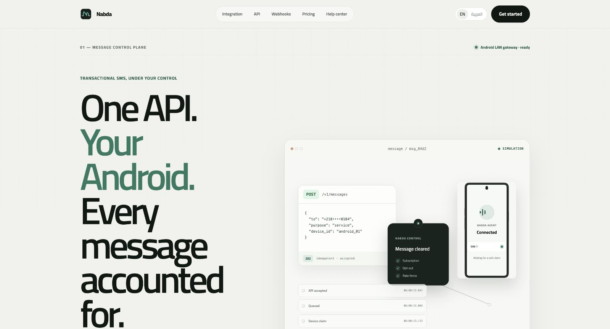

# نبضة · Nabda

**A messaging platform built around an Android phone and its SIM.**

[Back to selected work](../README.md)

## Product preview

Captured from the local product website. The visible message flow is the site's built-in simulation with a masked example phone number.

## The idea

Give a business a way to queue expected service messages through its own connected Android phone, with a local controller or a self-hosted API.

نبضة يربط هاتف أندرويد بلوحة تحكم محلية أو API، لتنظيم طابور الرسائل ومتابعة حالتها.

## Development scope

- A lightweight native Android agent.
- A Windows controller with a browser dashboard, local storage and QR pairing.
- A self-hosted, multi-tenant API with durable message queues.
- Duplicate protection, message expiry, opt-outs, audit logs and signed webhooks.
- API documentation and integration examples.

## Technology

TypeScript · Fastify · Java / Android · PostgreSQL · Redis / BullMQ · SQLite

## Availability

This is a product overview. Source code and deployment configuration remain private; a public demo is not currently linked.
