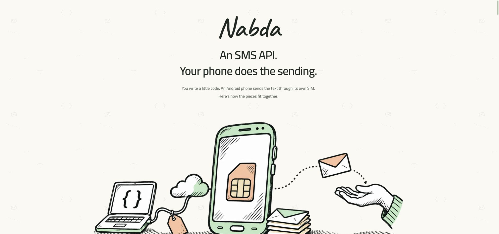
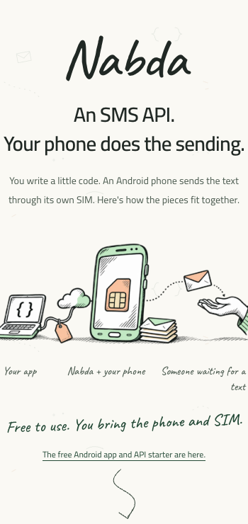
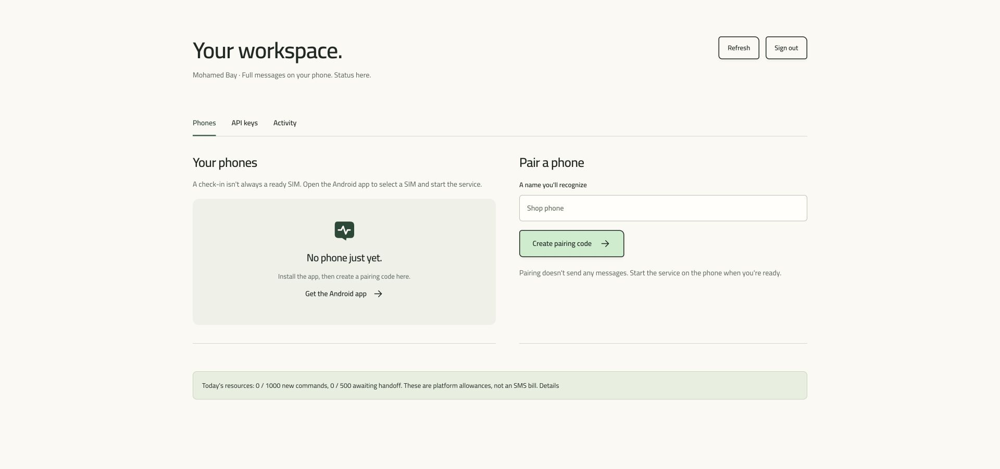

# Nabda — Your phone, an SMS API

I built Nabda so an application can send a text through an Android phone and its own SIM. The phone keeps the queue and message history. A small API handles requests, phone pairing and reported results.

[Live website](https://nabda-phone-api.netlify.app/) · [API dashboard](https://nabda-api.mohamed-kbay.workers.dev/dashboard) · [Public source](https://github.com/mohamedkbay/Nabda) · [Installation and hosting](https://github.com/mohamedkbay/Nabda/blob/main/docs/DEPLOYMENT.md)

**Availability:** Early public release. The website is live on Netlify and the API/dashboard is deployed on Cloudflare. Public source, an Android test APK and integration clients are available. Live GitHub sign-in was verified on 9 November 2026; physical-device and carrier checks are still required. The APK is a debug-signed test build.

## The new interface

The public guide is one long illustrated page. Hand-drawn scenes follow a request from an application to the phone, through its saved queue and back to a result. It uses Cairo, warm paper, green ink and transparent illustrations, with API details in the same document.

The desktop capture shows the published Netlify website on 9 November 2026. The mobile capture shows the same illustrated interface in the local build from 8 November. No account, phone number or message record is shown.

## My contribution

I work on the Android gateway, server API, pairing flow, account dashboard and integration tools. I also designed the illustrated guide to explain what happens to a message without hiding the technical details.

The separate account dashboard is where a user pairs a phone, creates an application key and reviews reported status. Its GitHub sign-in flow runs on the API's own origin. I verified the live sign-in with my own empty workspace on 9 November 2026.

The dashboard capture shows the live Cloudflare deployment after sign-in. Only my public display name is visible; no phone is paired, no messages have been submitted, and no application key, pairing token or private email is shown.

## How a message moves

1. An application submits a request with its API key and an idempotency key.
2. The server saves the command until the paired phone can receive it.
3. Android saves it in SQLite, then asks the server to acknowledge the handoff.
4. Only the approved handoff allows the phone to start the local job. The server clears its temporary copy of the text and recipient.
5. The selected SIM sends the SMS. The phone keeps attempts and part results, then uploads status when it has internet.

Once a phone has received approved work, it can continue that work if its internet drops. New requests and result uploads wait for connectivity. If a restart leaves a modem attempt uncertain, the phone records an unknown outcome rather than blindly resending the same text.

## What's included

- A native Android gateway with QR pairing, explicit SIM selection and a durable local queue.
- A TypeScript API with hashed application/device credentials, tenant isolation, validation and idempotent requests.
- Status lookup, usage reporting, scheduling, expiry and cancellation with handoff-aware behavior.
- Sandbox mode, a phone blocklist and bounded platform allowances.
- A React account dashboard and an English illustrated developer guide.
- OpenAPI 3.1, Postman files and small Node.js/Python clients.
- Independent deployment configuration for Cloudflare Workers/D1 and a static Netlify website.

## Technology

TypeScript · React · Cloudflare Workers · D1 · Java / Android · SQLite · HTML / CSS

## Availability and limits

Nabda is free to use; optional support does not change access. Real SMS uses the owner's phone, SIM and carrier agreement. API acceptance is separate from carrier submission or delivery.

The website and API are deployed independently on Netlify and Cloudflare. Current verification covers API behavior, sandbox handoff, desktop/mobile pages, public endpoints and a successful live GitHub sign-in to my own workspace. That sign-in check did not pair a phone or submit messages. These checks do not establish real carrier delivery or Android background reliability on every device; physical-phone and SIM testing is still required.

[Source, setup and integration details](https://github.com/mohamedkbay/Nabda) · [Image context](../assets/README.md) · [All projects](../PROJECTS.md)
