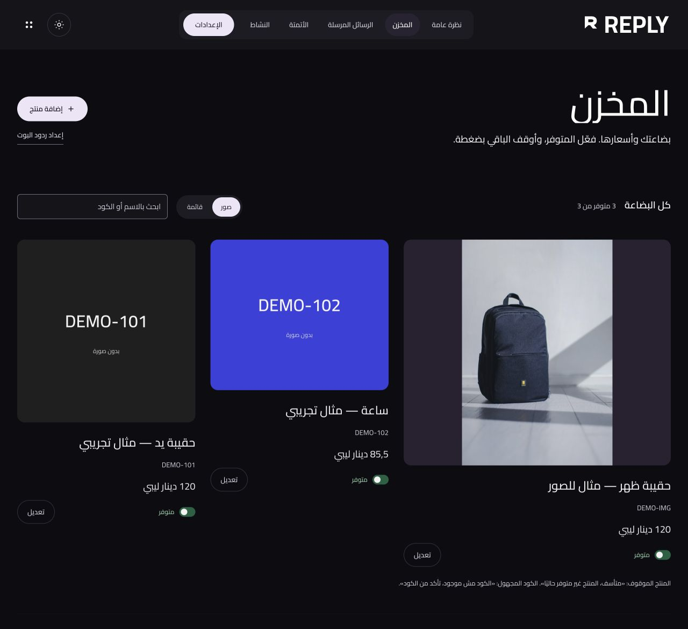
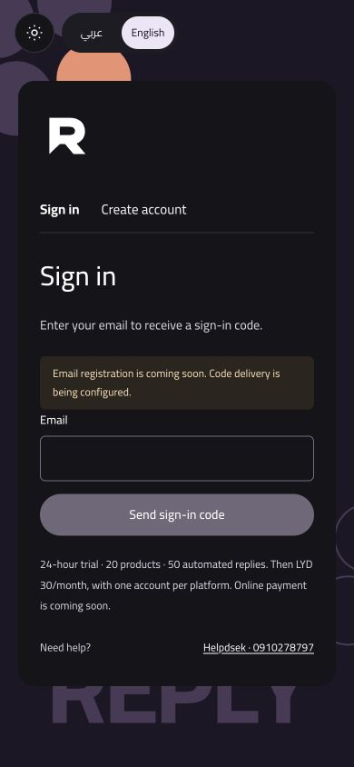

# REPLY · Merchant inventory & product replies

**An Arabic-first workspace that turns a product code into a clear answer.**

[Public source & documentation →](https://github.com/mohamedkbay/REPLY) · [Back to selected work](../README.md)

REPLY يساعد التاجر ينظّم المنتجات والأسعار والتوفر، ويردّ على استفسارات الزبائن انطلاقاً من كود المنتج وبيانات المخزون. الواجهة عربية وإنجليزية، والردود الحالية مبنية على قواعد وبيانات محفوظة، من غير توليد أسعار بالذكاء الاصطناعي.

## The merchant workflow

1. The merchant saves a product code, name, price, currency, availability and optional photo.
2. A customer asks about a price or sends a photo; the configured response asks for the product code.
3. A known code returns the saved product details. Unavailable products and unknown codes receive the corresponding response.
4. The merchant maintains keyword automations and editable business answers, and inspects previews and reply activity.

Incoming photos prompt code guidance; the current implementation does not identify products visually or call a language model.

## Interface previews

An existing local development capture with synthetic products and illustrative prices. This inventory capture predates the latest compact header-symbol refinement; it is not a live merchant account or a sales result.

The matching sign-in captures show the English interface. Arabic RTL is the default, with English LTR, locally served Cairo, responsive layouts, light/dark modes and reduced-motion support. Email delivery is visibly disabled in these unconfigured local previews.

## Development scope

Reply extends an existing open-source automation foundation with a merchant-focused inventory workflow, product media, connected-channel adapters, bilingual interface and identity, and a separate Node customer-service pilot.

- Product codes, prices, currencies, availability, optional photos, search and list/gallery views.
- Product answers, editable business topics, keyword rules, preview and activity surfaces.
- Adapters for Instagram, Messenger, WhatsApp and Telegram; a separate, bounded TikTok workflow handles public comments on selected owned videos.
- Email-code authentication, isolated customer workspaces and limited-trial controls in the Node pilot.
- Automated tests for matching, authentication, workspace isolation, callback verification, duplicate handling and image/text fallback.

The underlying foundation is [Paul Millerd’s manychat-lite-cloudflare](https://github.com/paulmil11/manychat-lite-cloudflare), credited in the [MIT license](https://github.com/mohamedkbay/REPLY/blob/main/LICENSE) and [attribution records](https://github.com/mohamedkbay/REPLY/blob/main/NOTICE.md). This overview describes the custom extension work; it does not claim sole authorship of that foundation.

## Technology

TypeScript · Node.js · SQLite · server-rendered HTML/CSS and browser JavaScript. A separate Cloudflare Workers/D1 prototype shares the domain logic. Deployment preparation includes Docker and Caddy.

## Status and verification

**Status: open-source, locally verified pilot.** This is a product overview, not an announcement of a publicly launched service.

On 19 October 2026, a fresh local review of the uploaded snapshot passed **158 automated tests**, TypeScript checking, the Worker dry-run bundle, the Node bundle and the workerd/D1 runtime checks. Provider traffic in these tests is mocked; passing them does not establish live platform permissions or message delivery.

Live enrollment still requires configured email delivery, approved platform access, public HTTPS callbacks and operational validation. The Node pilot does not yet schedule the separate daily Instagram-token renewal path. Online checkout and customer-facing paid activation are not implemented. TikTok support is public text comments on selected owned videos, not general inbox automation.

## Availability

The application source and setup guides are now [public on GitHub](https://github.com/mohamedkbay/REPLY) under the MIT license. This overview presents the product and selected development screenshots; real credentials and operational customer data are not part of the showcase. See [image sources and attribution](../assets/README.md).
