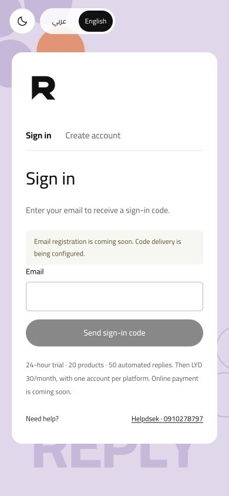
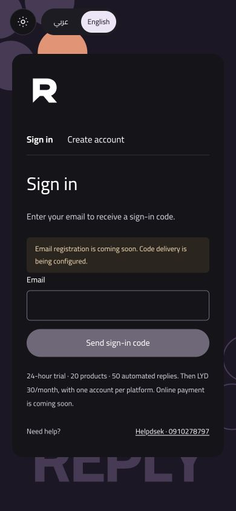

# REPLY

**Product owner: Mohamed Bay.**

REPLY is a merchant workspace for organizing inventory and answering product inquiries using product codes.

[Back to selected work](../README.md)

## Product screenshots

### Inventory

### Mobile sign-in

These local development previews use fictional inventory and empty sign-in fields. See [image sources and attribution](../assets/README.md).

## Availability

The application source is private. This page presents the product and selected screenshots only.
