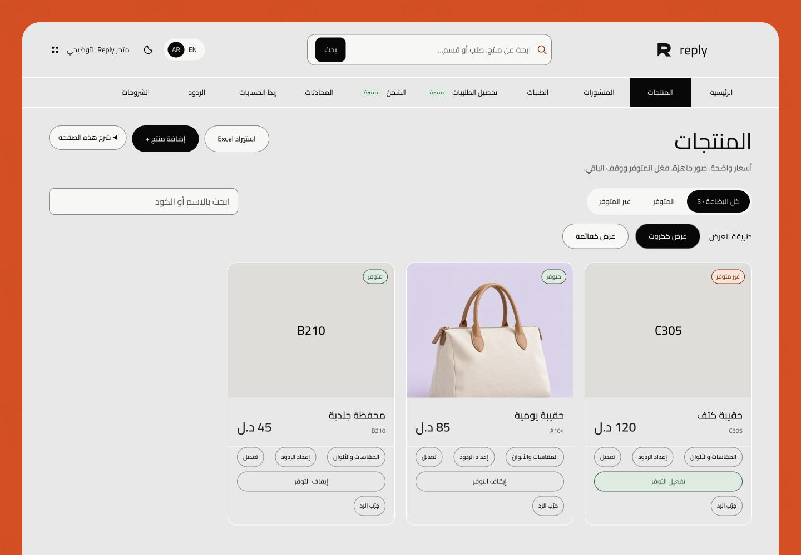
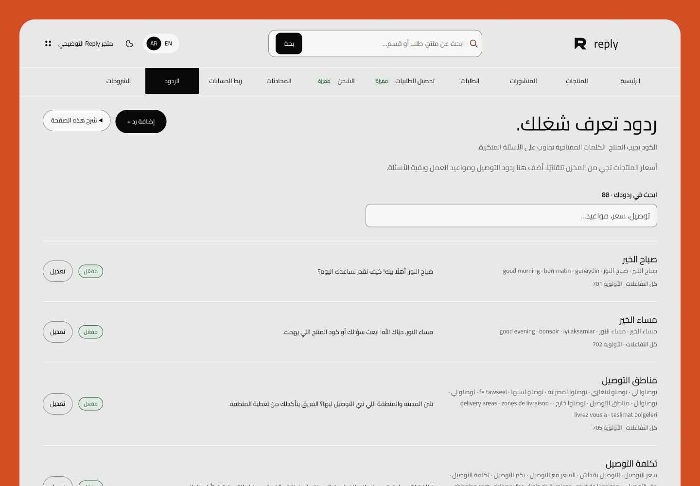
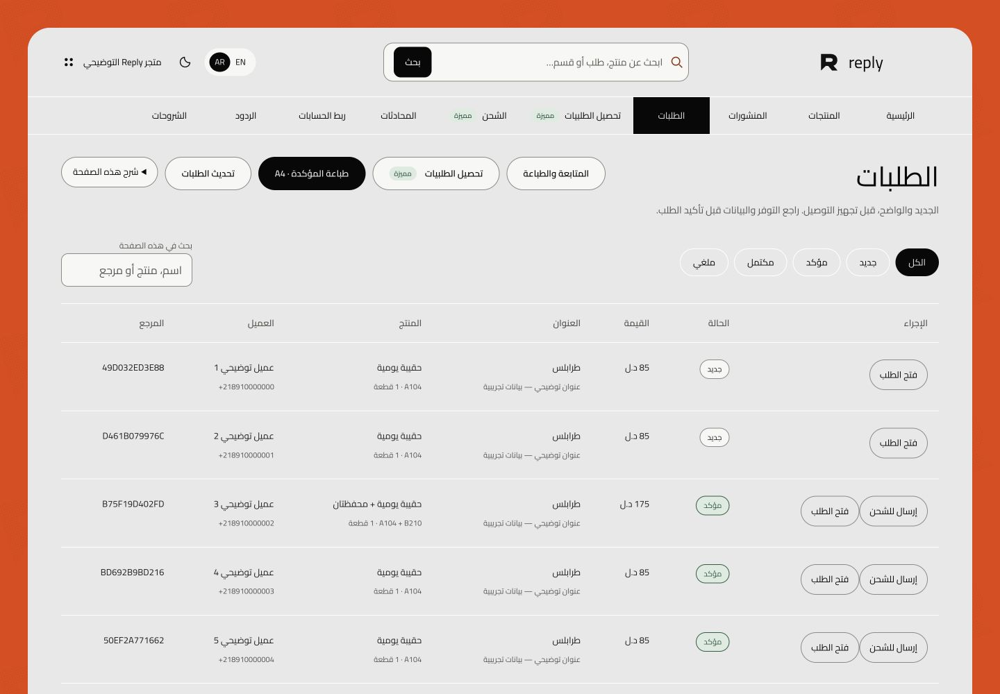
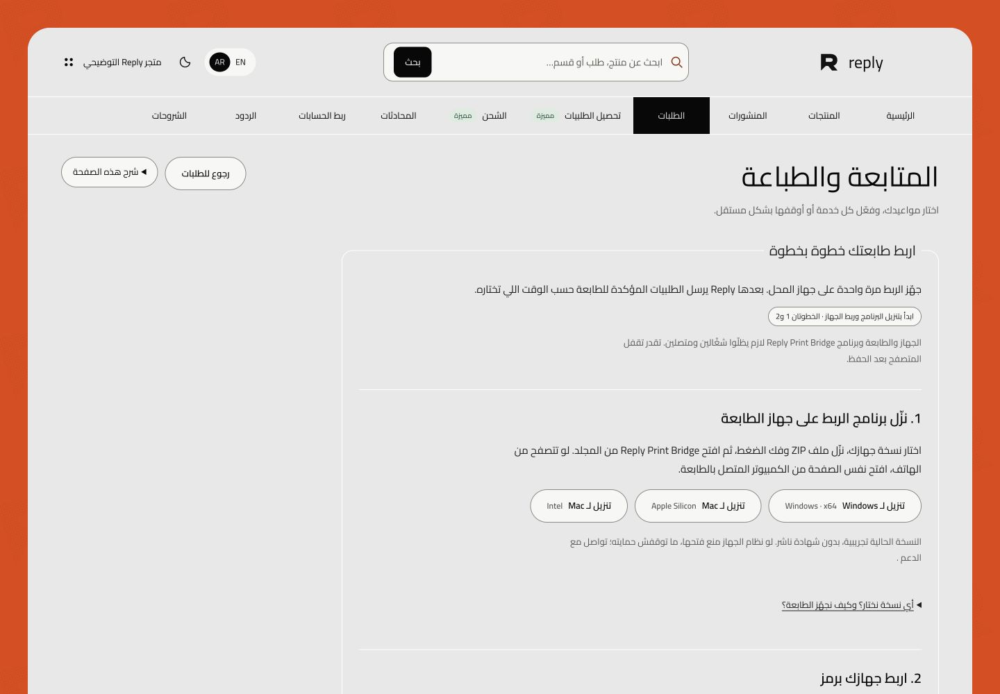
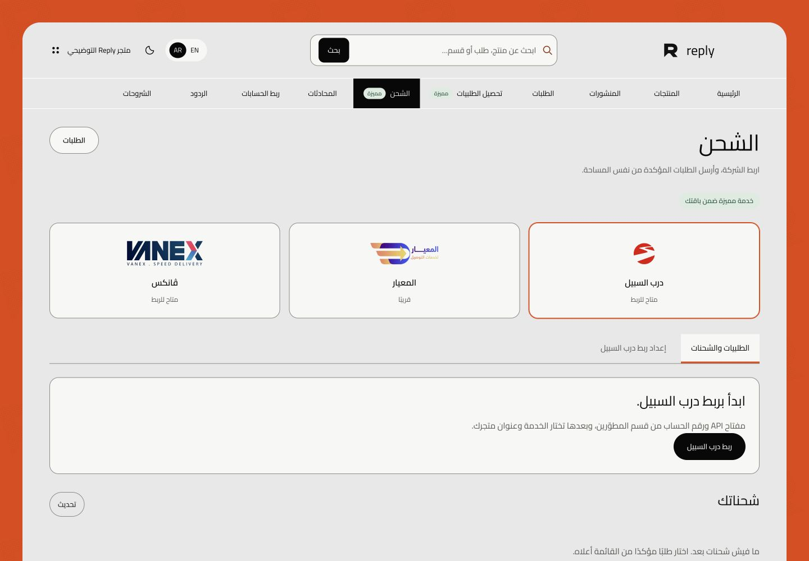
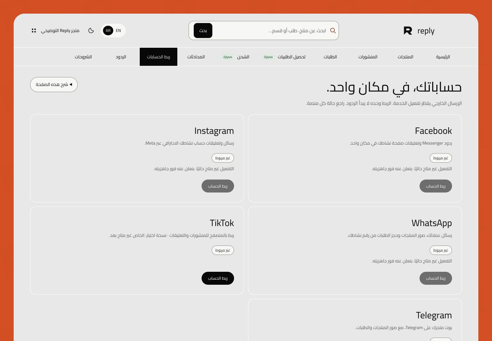

# REPLY — My Flagship Product

**Product owner & lead developer: [Mohamed Bay](https://github.com/mohamedkbay)**  
**Company:** [Etaar Digital Systems](https://etaar.ly) · **Period:** January 2026–present

REPLY is my main product and ongoing development focus: an Arabic-first workspace that connects a merchant’s products, customer replies and order operations.

**REPLY is my flagship project.** I’m Mohamed Bay, its product owner and lead developer, and I lead its development through Etaar Digital Systems. We are building REPLY to support merchants from the first product inquiry through order review, preparation and delivery follow-up. Our ambition is to make it the first choice for merchants across the Arab world by offering practical value and competitive pricing.

[Visit REPLY](https://raply.ly/) · [Features](https://raply.ly/features) · [Interactive feature tour](https://raply.ly/#tour) · [Plans](https://raply.ly/pricing) · [Start a trial](https://raply.ly/auth/signup) · [Sign in](https://raply.ly/auth/login)

## What I own and build

I own the REPLY product and lead its product direction, interface design, engineering and ongoing development. My work brings together:

- A product catalog with codes, images, prices, availability and product options.
- Product-code answers, editable business replies and keyword automations.
- Customer order collection, merchant review and order confirmation.
- Delivery reports, package labels and a companion workflow for printing.
- Collections and shipping workflows, subject to the plan and carrier setup.
- Arabic/English interfaces, light/dark appearance, responsive web access and mobile application development.

The current work spans TypeScript, Node.js, SQLite, API integrations and an Expo/React Native mobile codebase. Native distribution and individual provider activation have their own requirements.

## Current interfaces · November 2026

These are actual application captures from the current orange/gray interface, using an isolated synthetic merchant fixture. Customer names, phone numbers, products, prices and orders shown in the captures are demonstration data.

### Products

Maintain product codes, prices, images, options and availability in one workspace.

### Replies

Manage the greeting, product-code responses and editable business rules.

### Orders

Review the customer’s selections and delivery details before confirming an order.

### Printing and preparation

Configure the companion printing workflow for confirmed orders and package preparation.

### Shipping

Prepare carrier connections and shipment workflows from confirmed orders. Carrier accounts, plan access and merchant confirmation are required.

### Account connections

The connections screen shows each provider’s configuration and availability. A listed provider does not imply that every channel or permission is active.

## Project links

| Destination | Link |
| --- | --- |
| Official website | [raply.ly](https://raply.ly/) |
| Features | [Product-to-order workflow](https://raply.ly/features) |
| Interactive overview | [Eight feature categories](https://raply.ly/#tour) |
| Plans and current terms | [Pricing](https://raply.ly/pricing) |
| Trial registration | [Create an account](https://raply.ly/auth/signup) |
| Existing users | [Sign in](https://raply.ly/auth/login) |
| Platform requirements | [Connection methods and availability](https://raply.ly/platforms) |
| Product owner | [Mohamed Bay on GitHub](https://github.com/mohamedkbay) |
| Software services | [Etaar Digital Systems](https://etaar.ly) |

## Availability

The public website and trial registration are online. The website currently advertises a seven-day trial; paid subscription activation is shown as coming soon. Check the live pricing and platform pages for current terms and supported connection methods.

Application source, account credentials and operational customer records remain private. This public page presents the product, my contribution and selected interfaces.

## Foundation and image context

REPLY’s source retains attribution to [Paul Millerd’s MIT-licensed upstream foundation](https://github.com/paulmil11/manychat-lite-cloudflare). My product ownership and development role include the REPLY-specific experience and ongoing engineering described above.

The six current screenshots come from the REPLY v2 product-tour source dated 5 November 2026. They were reviewed before publication and contain synthetic data only. See [image sources and attribution](../assets/README.md).

[Back to my selected work](../README.md) · [All projects](../PROJECTS.md)
