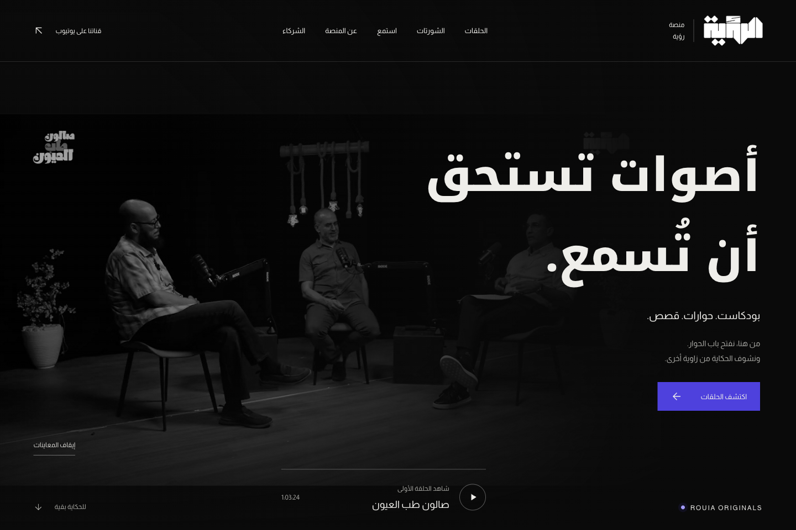
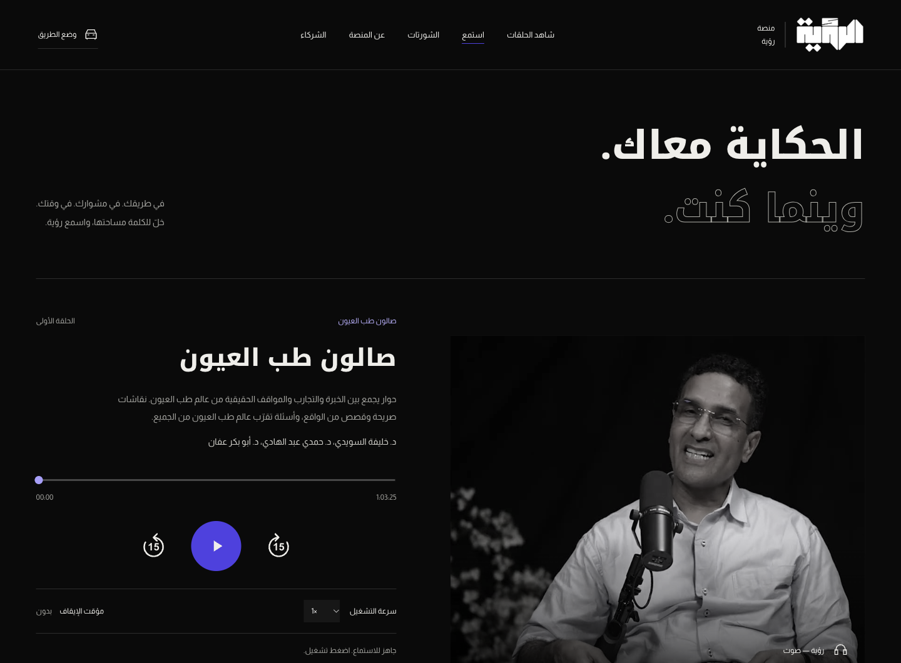
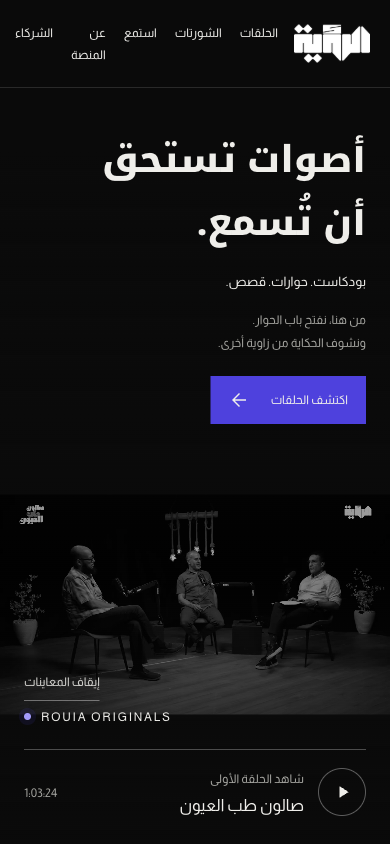
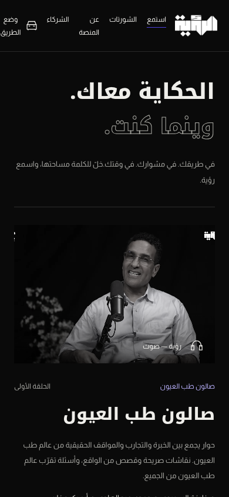

# ROUIA Platform

**Arabic podcasts, short conversations and an audio experience that follows the listener.**

[Open the platform →](https://podcast.alrouia.ly/) · [Listen](https://podcast.alrouia.ly/listen) · [Company website](alrouia.md) · [Back to selected work](../README.md)

ROUIA Platform is the podcast, shorts and audio-listening platform of Rouia Production & Marketing. Its current content focuses on the **Ophthalmology Salon** podcast, featuring conversations and professional experiences from ophthalmology.

**Availability:** Public visitor platform · private source and administration.

## My contribution

Web-platform development through **Etaar Digital Systems**: the Arabic episode and shorts experience, responsive audio player and navigation, partner and sponsorship flows, and private content-management workflows.

## Watch, listen and discover

- Full episodes and short clips, with previews and links to the original media sources.
- A dedicated listening page with saved position, 15-second seeking, playback speed and sleep timer.
- A persistent mini-player across internal navigation in the same tab, plus a road mode with larger controls.
- Arabic RTL, responsive desktop and phone layouts, and reduced-motion support.
- About, partner and sponsorship-interest pages. The full application includes private episode, shorts and sponsorship-request management backed by SQLite.

Background playback and lock-screen controls depend on the phone and browser; closing the tab or browser stops playback. The full Node application and static presentation build have different administration capabilities: the static preview does not provide operational editing or data storage.

## Interface previews

Existing project documentation captures, reviewed on 20 October 2026. Only visitor-facing screens are shown; no administration screens, sponsorship submissions or customer records are included.

## Technology and status

HTML · CSS · JavaScript · Node.js · SQLite. The project includes a full server application and a separate static showcase build.

The official public homepage was accessible during this portfolio update on 20 October 2026. Feature scope above follows the project documentation; this update did not test private administration or submit a sponsorship request.

## One studio, two web experiences

**[The company website](alrouia.md)** presents production work and services. **ROUIA Platform** focuses on watching episodes, discovering shorts and continuing in audio.

**Availability:** public visitor platform, private source and administration. [Image context and credits](../assets/README.md).
