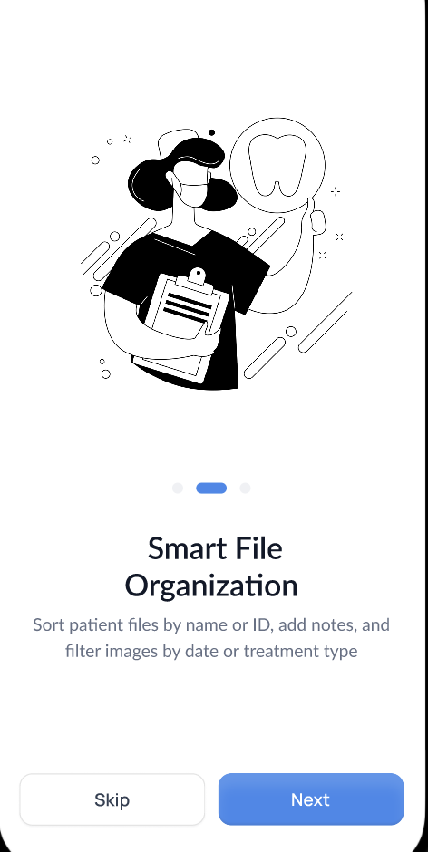

# UpDent

**A mobile app for dental clinic workflows, available for Android and iOS.**

[Website](https://updent.ly) · [App Store](https://apps.apple.com/ly/app/updent/id6754293517?l=ar) · [Google Play](https://play.google.com/store/apps/details?id=com.bensuliman.updent&hl=en) · [Back to selected work](../README.md)

**Availability:** Android & iOS app · private source; companion web tools have their own development stage.

## App previews

**Dashboard · Follow-up management · Onboarding**

The first two images are published App Store promotional screenshots. The onboarding screen comes from the public UpDent website. [Image sources](../assets/README.md).

## Overview

Help dentists and their teams organize patient records, document treatment and follow cases from one mobile workflow.

## My contribution

Mobile application development, product interfaces and companion web workflows for dental teams.

## Product scope

- Patient records, visit history and clinical notes.
- Treatment and procedure tracking, including follow-ups.
- Appointment scheduling and clinic organization.
- Clinical photos and case documentation.
- Companion web interfaces for working from a larger screen.
- A product website and an early-access request flow for the web platform.

## Presentation

The public website links to the Android and iOS applications. The companion web projects are presented separately from the mobile app; their development stage can differ. Source code and clinic data remain private.
